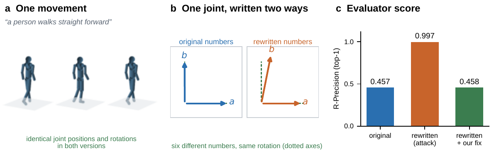

# Same Motion, Different Scores

**How the encoding of rotations changes motion metrics** — code and evidence for an anonymous CVPR 2027 submission.



Learned evaluators score generated human motion. Joint rotations are usually stored as six numbers (the continuous 6D representation), but only three of them determine the rotation. The other three can be changed without moving a single joint, and the evaluators respond to them. This repository contains:

- **`canon6d`**, a small library that canonicalizes 6D rotations before evaluation so that a score depends only on the represented movement;
- the experiments of the paper, with frozen protocols, aggregate results and independent verification;
- the manuscript sources ([`paper/current/`](paper/current/README.md)).

## Quick start

```bash
pip install -e .            # NumPy only; add [torch] for the differentiable version
python -m unittest discover -s tests
```

```python
import numpy as np
from canon6d import canonicalize

# raw (unnormalized) HumanML3D features [N, T, 263] or KIT-ML [N, T, 251]
x = canonicalize(raw_features, lengths)   # only the rotation channels change
z = (x - mean) / std                       # then the evaluator's own normalization
```

Apply the same function to generated and reference motion. For learned rewards during training, use `canon6d.torch.canonicalize`, which is differentiable. `canon6d.recode` rewrites rotations without changing them, which is what you need to audit your own evaluator: score `x` and `recode(x, ...)` and compare.

## Main results

All score changes below happen with every joint position and rotation unchanged (verified independently of the scores).

| Finding | Result |
|---|---|
| A fixed, caption-free rewriting of real HumanML3D motion | FID 0.001 → 3.64, eight times MDM's FID |
| Equal-size change inside the rotation channels | redundant directions move FID 7.7× more than real rotations |
| Canonicalizing released outputs of 10 generator settings | FID changes in all 10; in 6 it exceeds the authors' reported margin; no ranking flips |
| Caption-targeted rewriting with evaluator gradients | R-Precision 0.457 → 0.997 (T2M), 0.578 → 0.993 (TMR) |
| Caption-blind rewriting, evaluator gradients | FID −39 to −53% (MDM), −59% (MLD); carries over to a second checkpoint |
| Query-only rewriting, no gradients | FID −11 to −57% after 300 queries; carries over to an unqueried checkpoint |
| Learned rewriting layer, sign-language backtranslation | PHOENIX-2014T BLEU 6.39 → 15.21; How2Sign +2.64; CSL-Daily +0.54 |
| Canonicalization | identical outputs for every rewriting; no measured accuracy cost |

## Repository layout

| Path | Contents |
|---|---|
| [`canon6d/`](canon6d/) | The canonicalization library (NumPy core, optional PyTorch) |
| [`tests/`](tests/) | Contract tests for `canon6d` |
| [`scripts/`](scripts/README.md) | Experiment producers, analyses and independent verifiers |
| [`results/`](results/README.md) | Exported aggregate evidence with SHA256 fingerprints |
| [`paper/current/`](paper/current/README.md) | Manuscript and supplement sources; reviewed PDFs in `reviewed/` |
| [`docs/`](docs/reproduction.md) | Reproduction guide, data layout and evaluation contract |
| `configs/`, `requirements/`, `tools/` | Pinned external sources, environments and repository checks |

## Reproducing the paper

- [`docs/reproduction.md`](docs/reproduction.md) maps every result in the paper to its producer, analysis and verification script.
- [`docs/evaluation-contract.md`](docs/evaluation-contract.md) states the evaluation interface we recommend.
- [`docs/data-and-artifacts.md`](docs/data-and-artifacts.md) lists what stays outside Git: datasets, model weights and the full frozen experiment archive.

`make check` validates the repository, exported evidence and manuscript inputs without a GPU. `make paper` builds the PDFs (requires [Tectonic](https://tectonic-typesetting.github.io/)).

## Data and licenses

No dataset, model weight or third-party code is redistributed here. PHOENIX-2014T, How2Sign, CSL-Daily, HumanML3D and KIT-ML must be obtained under their original terms, and external models keep their own licenses; see [`NOTICE.md`](NOTICE.md).

## Citation

```bibtex
@inproceedings{anonymous2027samemotion,
  title     = {Same Motion, Different Scores: How the Encoding of Rotations Changes Motion Metrics},
  author    = {Anonymous},
  booktitle = {Submitted to the IEEE/CVF Conference on Computer Vision and Pattern Recognition (CVPR)},
  year      = {2027}
}
```
